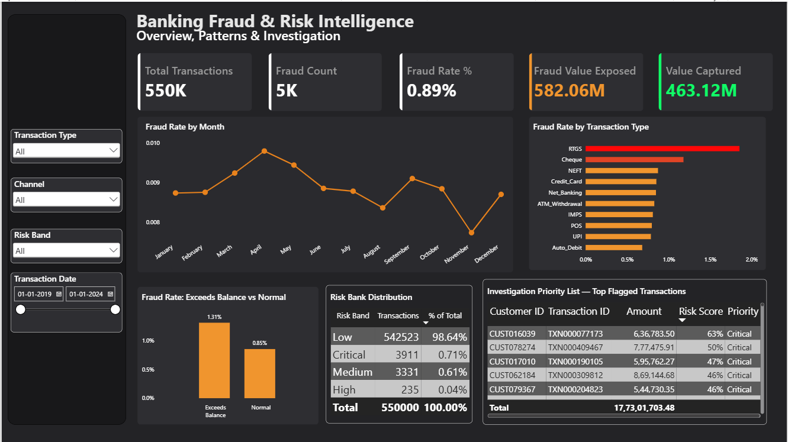

# Banking Fraud & Risk Intelligence System

End-to-end analysis of 550,000 Indian banking transactions: fraud pattern discovery in SQL, leakage-safe feature engineering, three machine learning models evaluated under severe class imbalance, SHAP explainability, a risk-scoring system for investigation prioritization, and a Power BI dashboard.



**Headline numbers**
- Fraud is only **0.886%** of transactions (4,873 of 550,000), but represents **₹58.2 crore** in exposed value.
- On a held-out test set the model never saw, reviewing just the **197** highest-risk transactions (0.18% of volume) surfaced **14 real fraud cases worth ₹1.28 crore**, a hit rate of 7.1% versus a 0.886% baseline (about **8x** better than random review).

---

## 1. Business Objective

Fraud is rare but expensive, and investigation teams can only review a small share of transactions. This project asks: where does fraud concentrate, which behavioral signals separate it from normal activity, and how can a model help a team decide what to review first?

## 2. Dataset

- Indian Banking Transactions (synthetic), Jan 2019 to Jan 2024
- 550,000 rows, 20 original columns, ~79,900 customers
- Fraud rate 0.886% (4,873 fraud transactions)

**Known dataset quirks (investigated, not hidden)**
- `transaction_amount` and `account_balance` appear to have been generated independently: about 11.85% of debit transactions have an amount larger than the account balance. This turned out to be a useful fraud signal rather than something to clean away.
- `transaction_hour` is almost perfectly uniform across 24 hours (~22.5k to 23k transactions per hour), which suggests it was randomly assigned and not behaviorally realistic.
- Customers average only ~6.9 transactions (max ~12), so customer-level fraud analysis was statistically unreliable.

## 3. Pipeline

| Step | Tool | File | What was done |
|---|---|---|---|
| 1. Cleaning and understanding | Python | `notebooks/01_Data_Cleaning.ipynb` | Null handling, duplicate and consistency checks, outlier investigation |
| 2. Business analysis | MySQL | `sql/banking_fraud_analysis.sql` | Fraud rates by type, merchant category, state, hour, KYC, credit score, year |
| 3. EDA visuals | Python | `notebooks/02_EDA_Visuals.ipynb` | Charts supporting the key SQL findings |
| 4. Feature engineering | Python | `notebooks/03_Feature_Engineering.ipynb` | Behavioral features built without future-data leakage |
| 5. Modeling and risk scoring | Python | `notebooks/04_Fraud_Modeling.ipynb` | Logistic Regression, Random Forest, XGBoost, threshold tuning, risk bands, priority list |
| 6. Explainability | Python | `notebooks/05_Model_Explainability.ipynb` | SHAP global and local analysis |
| 7. Dashboard | Power BI | `dashboard/` | Single-page interactive dashboard |

## 4. Key Findings

### Where fraud concentrates (SQL)
- **Transaction type is the strongest standalone signal.** RTGS has a 1.854% fraud rate (about 2.1x the baseline) despite being a lower-volume type. Cheque is second at 1.179%. UPI, the highest-volume type, is among the safest at 0.786%.
- **No meaningful signal** was found in merchant category (0.778% to 0.934%), state (0.761% to 0.948%), KYC status (0.845% to 0.888%), credit-score band (0.852% to 0.908%), hour of day, or year (2019 to 2023). Each stayed close to the baseline. Ruling these out was tested explicitly.
- Customer-level repeat-fraud analysis was attempted and dropped: with ~6.9 transactions per customer, per-customer fraud rates are mostly noise.

### Engineered features
| Feature | Meaning | Fraud vs. legitimate | Signal |
|---|---|---|---|
| `exceeds_balance` | Debit amount larger than account balance | 1.31% vs 0.81% fraud rate (debit transactions) | Strong |
| `amount_to_balance_ratio` | Continuous version of the above, capped at 10 | mean 1.54 vs 0.79 | Strong |
| `amount_vs_customer_avg` | Amount relative to the customer's own prior average, capped at 10 | mean 2.45 vs 1.86 | Moderate |
| `days_since_last_transaction` | Gap since the customer's previous transaction | mean 215 vs 221 days | None |

Customer-relative features use only transactions that happened before each row, so the model never sees information that would not have been available at decision time.

### Models and threshold tuning
With fraud at 0.886%, a model that always predicts "not fraud" scores about 99% accuracy while catching nothing, so models were judged on precision, recall, and the share of transactions flagged for review. All results below are on a stratified 20% held-out test set (110,000 rows, 975 fraud cases).

- **Logistic Regression** (baseline): with class balancing, 30% recall at 1% precision, with 26,455 false positives.
- **Random Forest**: the default 0.5 threshold caught 1 of 975 fraud cases. A first "optimized" threshold of 0.02 reached 61% recall but flagged **55.6% of all transactions**, which no review team could handle. Re-tuning with flagged volume as an explicit constraint gave a threshold of **0.10**: about 1.28% of transactions flagged, 8.4% recall, about 6% precision.
- **XGBoost**: tested with three class-weight settings. The full class ratio (110) flagged 74% of transactions, a weight of 10 was too conservative, and a weight of 30 still flagged about 64% at threshold 0.10. In the configurations tested, none gave a usable operating point that beat the tuned Random Forest, which suggests the limit here is the signal in the features and not the choice of algorithm.

### Explainability (SHAP)
- Random Forest's built-in `feature_importances_` ranked `exceeds_balance` outside the top 15, despite its clear fraud-rate difference. SHAP showed why: `exceeds_balance` correlates 0.537 with `amount_to_balance_ratio` (both are derived from the same two columns), so the model relies on the continuous version and treats the flag as largely redundant.
- Class balancing shifts the model's baseline prediction to roughly 50/50, so individual SHAP explanations must be read relative to that baseline, not the true 0.886% rate.

### Risk scoring and investigation prioritization
Test-set transactions were placed in risk bands from the model's fraud probability (Medium from 0.10, High from 0.25, Critical from 0.40):

| Band | Transactions | Fraud rate |
|---|---|---|
| Low | 108,589 | 0.82% |
| Medium | 1,214 | 5.60% |
| High | 184 | 6.52% |
| Critical | 13 | 15.38% (about 17x baseline) |

Fraud rate rises steadily with band. The Critical band holds only 13 transactions in the test set, so its 15.38% is directional and not a precise estimate. Reviewing the 197 High and Critical transactions would have surfaced 14 fraud cases worth ₹1.28 crore.

## 5. Dashboard

A single-page Power BI dashboard (`dashboard/Banking_Fraud_Risk_Dashboard.pbix`) with: KPI cards, monthly fraud-rate trend, fraud rate by transaction type, fraud rate for exceeds-balance vs normal transactions, a risk-band distribution table, and an investigation priority list with real transaction IDs ranked by risk score.

**Important note:** the dashboard scores all 550,000 transactions, which includes the 440,000 the model trained on, so the **Value Captured** card and the **risk-band distribution table** reflect in-sample scores and are illustrative. The **investigation priority list** is filtered to the held-out test set (`is_test_set = TRUE`). All model performance numbers in this README come from the held-out test set.

## 6. Limitations

- The data is synthetic. Patterns real banking data would likely show (time-of-day clustering, KYC-status effects) are absent because the generator did not simulate them.
- Precision at a usable review volume is modest (about 6%), and recall is about 8%. This reflects how hard fraud detection is under severe imbalance, but it also means the model is a prioritization aid, not a fraud detector on its own.
- SHAP ranked `days_since_last_transaction` and `credit_score` among the most influential features, even though univariate analysis found no fraud-rate difference for them. This may reflect feature interactions or the model fitting noise, and was not investigated further.
- SHAP values were computed on a 200-row sample for speed, so the global ranking is approximate.
- The Critical risk band has very few test transactions (13), so its fraud rate is not statistically stable.

## 7. Tech Stack

Python (pandas, NumPy, scikit-learn, XGBoost, SHAP, Matplotlib, Seaborn), MySQL, Power BI, Jupyter

## 8. Repository Structure

```
banking-fraud-risk-intelligence/
├── data/               (large CSVs are provided as .zip files; unzip before running the notebooks)
├── notebooks/
│   ├── 01_Data_Cleaning.ipynb
│   ├── 02_EDA_Visuals.ipynb
│   ├── 03_Feature_Engineering.ipynb
│   ├── 04_Fraud_Modeling.ipynb
│   └── 05_Model_Explainability.ipynb
├── sql/
│   └── banking_fraud_analysis.sql
├── dashboard/
│   └── Banking_Fraud_Risk_Dashboard.pbix
├── images/
└── README.md
```

## 9. Author

Anchita Bose
